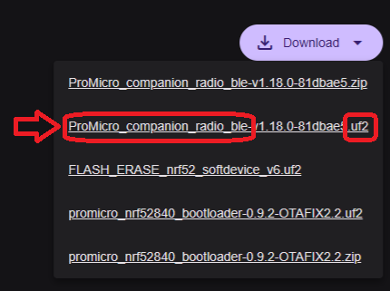
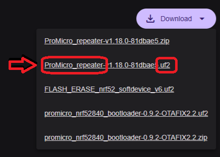
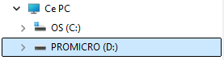
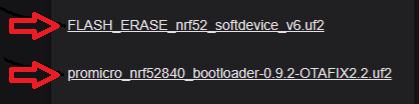

# Upgrade MeshCore Firmware on ProMicro nRF52

## 1. Get the right file

1. Open the page for the role you want:
   - Companion : https://flasher.meshcore.io/promicro-nrf52-faketec/companion-bluetooth/
       
     
   - Repeater  : https://flasher.meshcore.io/promicro-nrf52-faketec/repeater/
       
     
2. Click **Download** to get a copy of the firmware files.
3. Pick the `.uf2` file

## 2. Enter bootloader mode

1. Plug the board into your computer with a **data-capable** USB cable.
2. **Press the RESET button TWICE** in quick succession.
3. The board should appear as a USB drive (drive name: `PROMICRO`).
   
   

## 3. Flash the file

1. Drag and drop the `.uf2` file onto the USB drive.
2. Wait for the copy to finish. The drive should disappear and the board should reboot.

   **Tip:** Windows may show copy error 0x80070022 ("The drive does not contain the right disk") right after you drop the `.uf2` file.
   The board reboots as soon as the file is written, so the drive disappears before Windows can confirm the copy.
   This error is expected and can be safely ignored.

   **Tip:** This update preserves the node settings.
   

# Flash a new ProMicro nRF52

**If you are using a new ProMicro, you must flash the 3 files in order:**

1. Flash the file `promicro_nrf52840_bootloader-0.9.2-OTAFIX2.2.uf2`.
2. Flash the file `FLASH_ERASE_nrf52_softdevice_v6.uf2`.
3. Flash the MeshCore firmware you downloaded above: `promicro_xxxxx.uf2`.

